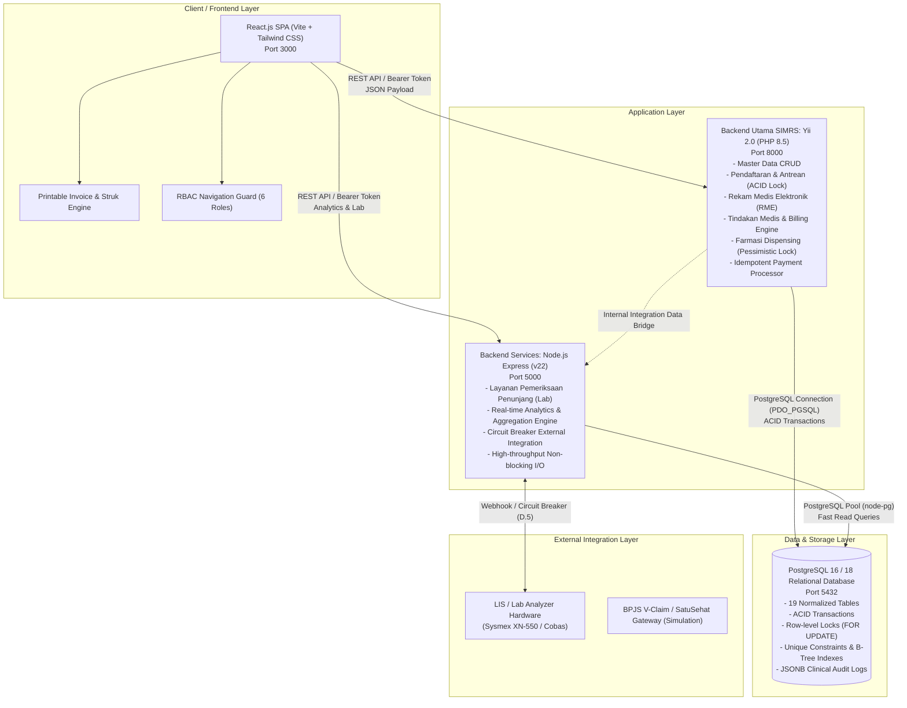

# ARSITEKTUR SISTEM & ALUR KOMUNIKASI SIMRS
## PT INOVA MEDIKA SOLUSINDO - REAL CASE TEST SENIOR PROGRAMMER
**Kandidat:** Arvin Ramdhan Fakhrudin  
**Posisi:** Senior Programmer  

---

## 1. Diagram Arsitektur Tingkat Tinggi (High-Level Architecture)



---

## 2. Alur Komunikasi Antar Komponen (End-to-End Communication Flow)

Sistem mengadopsi pola arsitektur **Hybrid Core & Microservices**:
1. **Frontend (React.js)** berkomunikasi dengan kedua backend menggunakan protokol standar **HTTP/REST** melalui format data **JSON** dan header otentikasi seragam:
   ```http
   Authorization: Bearer <access_token>
   Content-Type: application/json
   X-Idempotency-Key: <unique_transaction_key>
   ```

2. **Alur Pelayanan Pasien (Patient Journey Sequence):**
   ```mermaid
   sequenceDiagram
       autonumber
       actor P as Petugas Pendaftaran
       actor D as Dokter Poli
       actor F as Petugas Farmasi
       actor L as Petugas Lab
       actor K as Kasir
       participant UI as React Frontend
       participant Yii as Yii2 Core Backend
       participant Node as Node.js Service
       participant DB as PostgreSQL 16

       Note over P,DB: 1. Tahap Pendaftaran Pasien (Skenario D.1)
       P->>UI: Input Pendaftaran (Pasien + Poli + Dokter)
       UI->>Yii: POST /api/registrations
       Yii->>DB: BEGIN TRANSACTION
       Yii->>DB: Check Unique (patient_id, clinic_id, date)
       Yii->>DB: SELECT MAX(queue_seq) FOR UPDATE
       Yii->>DB: INSERT INTO registrations & bills (Biaya Pendaftaran)
       Yii->>DB: COMMIT
       Yii-->>UI: 201 Created (Nomor Antrean: POLI-UMU-001)

       Note over D,DB: 2. Tahap Pemeriksaan & RME Dokter
       D->>UI: Input Anamnesis, TTV, ICD-10, Tindakan, Resep & Lab
       UI->>Yii: POST /api/examinations
       Yii->>DB: INSERT examinations & examination_services
       Yii->>DB: INSERT prescriptions & lab_requests
       Yii->>DB: Recalculate Bill (Pendaftaran + Tindakan + Resep + Lab)
       Yii-->>UI: 201 Created (RME Tersimpan & Tagihan Terupdate)

       Note over L,DB: 3. Tahap Pemeriksaan Penunjang (Node.js)
       L->>UI: Buka Permintaan Lab
       UI->>Node: GET /api/lab/requests
       Node->>DB: SELECT * FROM lab_requests JOIN patients
       Node-->>UI: 200 OK (Daftar Permintaan Lab)
       L->>UI: Input Hasil Uji (Hb, Leukosit, dll)
       UI->>Node: PUT /api/lab/results/:id
       Node->>DB: INSERT INTO lab_results & UPDATE lab_requests status COMPLETED
       Node-->>UI: 200 OK (Hasil Terverifikasi)

       Note over F,DB: 4. Tahap Farmasi & Resep (Skenario D.2)
       F->>UI: Buka Resep Masuk & Klik Dispense
       UI->>Yii: POST /api/prescriptions/:id/dispense
       Yii->>DB: BEGIN TRANSACTION
       Yii->>DB: SELECT stock FROM medicines FOR UPDATE
       Yii->>DB: UPDATE medicines SET stock = stock - qty WHERE stock >= qty
       Yii->>DB: UPDATE prescriptions SET status = 'DISPENSED'
       Yii->>DB: COMMIT
       Yii-->>UI: 200 OK (Obat Diserahkan, Stok Berkurang Aman)

       Note over K,DB: 5. Tahap Kasir & Pembayaran (Skenario D.3)
       K->>UI: Proses Pembayaran (Cash / QRIS)
       UI->>Yii: POST /api/bills/:id/pay (Header X-Idempotency-Key)
       Yii->>DB: Check Idempotency Key in payments table
       Yii->>DB: SELECT * FROM bills FOR UPDATE
       Yii->>DB: INSERT payments & UPDATE bills (Status PAID)
       Yii-->>UI: 201 Created (Lunas)
       K->>UI: Cetak Struk / Invoice Resmi (Printable Modal)
   ```

---

## 3. Pembagian Tanggung Jawab (Division of Responsibility): Yii2 vs Node.js

Untuk mencegah duplikasi business logic maupun inkonsistensi data (Ketentuan Teknis E.10), pembagian tanggung jawab didefinisikan secara tegas:

| Aspek / Domain | Backend Utama (Yii2 - PHP) | Backend Services (Node.js Express) | Justifikasi Arsitektur |
| :--- | :--- | :--- | :--- |
| **Karakteristik Utama** | **Transactional ACID Core** | **Event-Driven & Analytics Engine** | Memisahkan beban penulisan kritis (Write-Heavy) dari query baca/analisis (Read-Heavy). |
| **Domain Master Data** | Penuh (Pasien, Dokter, Poli, Tindakan, Obat). | Read-only (hanya referensi bila diperlukan). | Menjamin single source of truth untuk integritas entitas rumah sakit. |
| **Pendaftaran & Antrean** | Pembuatan nomor antrean, validasi jadwal, dan pencegahan duplikasi (D.1). | Konsumsi data antrean untuk dashboard widget. | Yii2 menjamin isolasi transaksi serializable saat counter antrean dikunci. |
| **RME & Konsultasi Dokter** | Input anamnesis, vital signs, ICD-10, tindakan, dan audit log amandemen (D.4). | Akses hasil rekam medis melalui API penunjang. | Data klinis terlindungi oleh model validasi ActiveRecord dan constraint database. |
| **Farmasi & Stok Obat** | Pengurangan stok atomik dengan *Pessimistic Locking* (`SELECT FOR UPDATE`) (D.2). | Pemantauan inventori obat menipis pada dashboard analitik. | Mencegah race condition fatal di mana stok obat habis dibeli bersamaan. |
| **Pemeriksaan Penunjang (Lab)** | Pencatatan permintaan awal dari dokter dan komponen biaya lab ke billing. | **Manajemen Hasil Lab, Integrasi Perangkat Medis (LIS), dan Webhook Eksternal (D.5)**. | Node.js unggul dalam asynchronous I/O, streaming data alat lab, dan penanganan webhook. |
| **Billing & Pembayaran** | Kalkulasi multi-komponen tagihan terpadu, status Lunas, dan Idempotency check (D.3). | Agregasi pendapatan kotor, piutang, dan tren kas masuk. | Menjaga konsistensi finansial kasir rumah sakit di bawah kontrol database transaction. |
| **Dashboard & Pelaporan** | Tidak memproses agregasi berat agar core transaction tidak bottleneck. | **Agregasi Statistik Operasional, Distribusi Kunjungan, dan Laporan Kinerja (D.6)**. | Node.js mengeksekusi query analitik berkecepatan tinggi tanpa mengunci tabel transaksional. |
