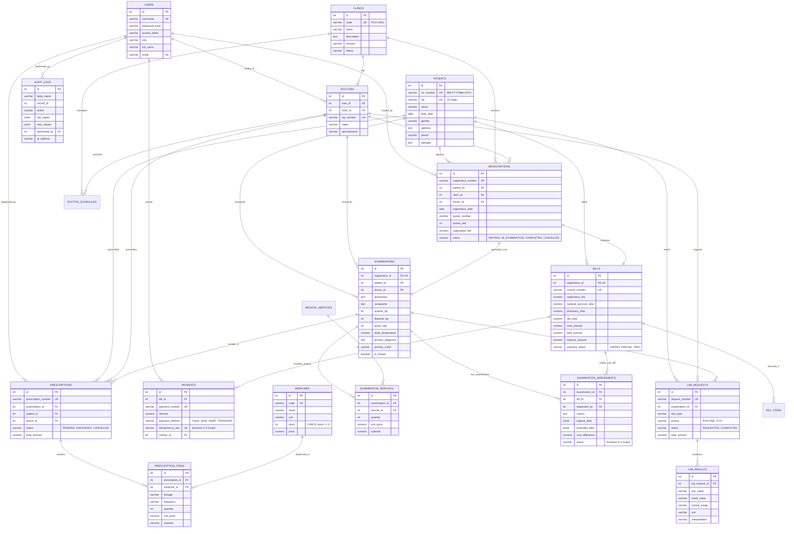

# ENTITY RELATIONSHIP DIAGRAM (ERD) & DATA DICTIONARY
## PT INOVA MEDIKA SOLUSINDO - REAL CASE TEST SENIOR PROGRAMMER
**Sistem:** SIMRS Pelayanan Rawat Jalan Terintegrasi  
**Database:** PostgreSQL 16+  
**Author:** Arvin Ramdhan Fakhrudin  

---

## 1. Diagram Relasi Entitas (Mermaid ERD)



---

## 2. Kamus Data & Integritas Relasional (Data Integrity Rules)

### A. Proteksi Integritas Utama:
1. **Unique Index Pencegahan Duplikasi Pendaftaran (`uq_patient_clinic_date`):**
   ```sql
   CONSTRAINT uq_patient_clinic_date UNIQUE (patient_id, clinic_id, registration_date);
   ```
   *Tujuan:* Mencegah satu pasien didaftarkan dua kali ke poliklinik yang sama pada tanggal yang sama, menyelesaikan permasalahan Skenario D.1 secara deterministik di level basis data.

2. **Check Constraint Non-Negative Stock:**
   ```sql
   ALTER TABLE medicines ADD CONSTRAINT chk_medicine_stock CHECK (stock >= 0);
   ```
   *Tujuan:* Menjamin basis data akan membatalkan (abort) transaksi apapun yang mencoba membuat stok bernilai negatif, melengkapi proteksi *Pessimistic Locking* pada Skenario D.2.

3. **Unique Index Idempotency Key Transaksi Kasir:**
   ```sql
   ALTER TABLE payments ADD CONSTRAINT uq_payment_idempotency_key UNIQUE (idempotency_key);
   ```
   *Tujuan:* Menjamin tidak akan pernah ada dua pembayaran yang tercatat dengan idempotency key yang sama saat terjadi gangguan jaringan atau retry otomatis (Skenario D.3).

4. **Tabel Amandemen Rekam Medis (`examination_amendments`):**
   *Tujuan:* Menyimpan riwayat perubahan diagnosis/tindakan lengkap dengan `original_data` (JSONB), `amended_data` (JSONB), alasan perubahan, dan otorisasi supervisor tanpa mengubah dokumen tagihan historis yang telah terbit (Skenario D.4).
